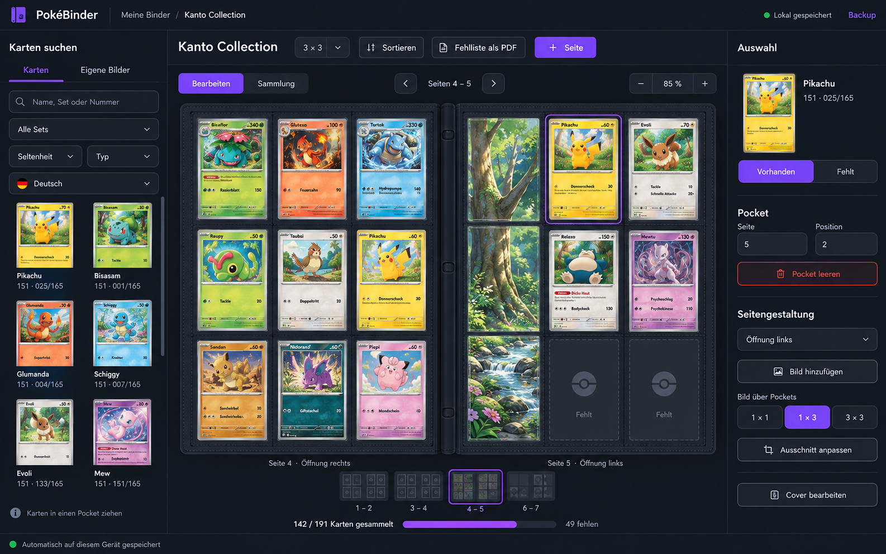

# PokéBinder – Requirements

Stand: 12.10.2026 – alle Phasen (0–6) und die danach vereinbarten Erweiterungen sind umgesetzt. Dieses Dokument beschreibt, was die App können muss und heute kann. Einzelentscheidungen mit Begründung stehen in `docs/DECISIONS.md`.

## Ziel & Vision

Eine Web-App, in der ich die Seiten meines Pokémon-Karten-Binders digital plane: Karten aus einer vollständigen Datenbank suchen, frei in ein Seiten-Grid (z. B. 3×3) legen und leere Pockets mit eigenen Bildern gestalten. Vorbild ist [pkmnbindr.com](https://www.pkmnbindr.com) – ein kostenloser digitaler Binder für Michi-Method-Binder, Master Sets und eigene Layouts.

Das Ergebnis soll so nah wie möglich am echten Binder sein: Doppelseiten, echte Pocket-Anzahl, und am Ende ein Export, den ich drucken oder teilen kann.

Die App ist nur für mich. Diese Liste ist die Grundlage, aus der Claude Code die App Schritt für Schritt baut. Jede Anforderung muss deshalb ohne Rückfrage prüfbar sein.

## Was die Referenz kann

pkmnbindr bewirbt Michi-Method-Binder, Master Sets, eigene Layouts, englische und japanische Karten, Cloud-Sync und Kartensuche. Details unten sind aus der Beschreibung und vergleichbaren Tools abgeleitet.

| Feature | pkmnbindr | Ähnliche Tools | Bei uns |
| --- | --- | --- | --- |
| Kartensuche in Datenbank | ja | ja | umgesetzt |
| Grid-Layouts | eigene Layouts | ja ([dextcg](https://dextcg.com/help/collection/binder-display-mode)) | umgesetzt (2×2, 3×3, 4×4) |
| Drag & Drop in Pockets | wahrscheinlich | ja ([AuraBinder](https://hunted.space/product/aurabinder)) | umgesetzt, Maus und Finger |
| Eigene Bilder, auch über mehrere Pockets (Michi Method) | ja | ja ([Pokébinder](https://www.productcool.com/product/pokebinder)) | umgesetzt |
| Master-Set-Binder automatisch aus einem Set | ja | – | umgesetzt, mit Holo-Option |
| Mehrere Sprachen | EN + JP | ja | umgesetzt (DE, EN, JP) |
| PNG-Export | unklar | ja (AuraBinder) | umgesetzt, pro Seite |
| Druckbare Platzhalter | unklar | ja (Pokébinder) | umgesetzt (Proxy-Druck A4) |
| Holo-Effekt | unklar | ja (AuraBinder) | umgesetzt |
| Preise | unklar | ja (AuraBinder) | umgesetzt (Cardmarket über TCGdex) |
| Accounts + Cloud-Sync | ja | teils | nicht geplant |

Die Michi Method ist der Kern: Statt jede Tasche gleich zu füllen, mischt sie Einzelkarten, Bilder über mehrere Pockets und bewusst freie Fläche.

## Funktionale Anforderungen

### Binder anlegen und verwalten

1. **Binder anlegen (Assistent).** Beim Erstellen fragt die App: „Leerer Binder“ oder „Master Set“?
   - Immer: Name, Pocket-Layout (2×2, 3×3, 4×4; Standard 3×3), Sprache der Karten und Standard-Öffnung der Pockets (links, rechts, gemischt).
   - Master Set: Ich wähle ein Set aus einer Liste, gruppiert nach Serie, mit Set-Logo und Kartenanzahl.
   - Checkbox „Mit Holo-Varianten“: an = jede Reverse-Holo- und Sonder-Reverse-Variante (z. B. Pokéball- oder Meisterball-Muster), die es im Set gibt, bekommt einen eigenen Pocket direkt hinter der Normalkarte.
   - „Secret Rares“ (nach Seltenheit wählbar) und „Promos“ (Promo-Set der Serie, standardmäßig aus, am Ende angehängt).
   - Danach erzeugt die App so viele Seiten wie nötig in Set-Nummernreihenfolge.
   - Ein bestehendes Master Set lässt sich nachträglich anpassen (Holo-Varianten, Secret Rares, Promos); die Karten werden neu einsortiert, Besitz-Markierungen bleiben.
2. **„Meine Binder“ als Regal.** Alle Binder stehen als Kacheln nebeneinander, jede mit ihrem Cover-Bild (ohne Bild: Cover-Titel), Name, Layout, Seiten- und Kartenzahl und Änderungsdatum.
   - Sortierung: „Zuletzt geändert“, „Alphabetisch“ oder „Eigene Reihenfolge“ (per Drag & Drop oder Pfeilknöpfen); die Wahl wird im Browser gemerkt.
   - Binder öffnen, umbenennen, löschen (mit Rückfrage).
3. **Binder umbenennen und Layout wechseln** im Editor über das Menü „Mehr“; ein Layout-Wechsel verteilt die Karten neu.

### Binder-Editor

4. **Doppelseiten-Ansicht mit Cover.** Ich sehe immer eine linke und rechte Seite wie im aufgeschlagenen Binder und blättere per Pfeiltasten oder Buttons.
   - Der Binder hat ein Cover mit eigenem Bild und Titel.
   - Seite 1 steht allein rechts neben der Cover-Innenseite, danach 2–3, 4–5 …
   - Zoom 50–150 % in Schritten von 5 %. Beim Öffnen wählt die App den größten Zoom, bei dem die Doppelseite ganz zu sehen ist (höchstens 80 %); ein von Hand gewählter Zoom bleibt.
   - Miniatur-Leiste zum Springen zwischen Doppelseiten; Seiten lassen sich hinzufügen, löschen, duplizieren, mittendrin einfügen und umsortieren (in der Leiste eine Seite auf eine andere ziehen, oder per Knopf).
5. **Einschub-Richtung.** Alle Pockets sind seitlich offen; pro Seite stelle ich ein, ob die Öffnung links, rechts oder gemischt liegt (ungerade Seiten: rechts, rechts, links; gerade Seiten: rechts, links, links).
   - Jeder Pocket zeigt seine Öffnung als dezente Markierung, auch im Export.
6. **Karten suchen.** Suche nach Name, Set und Nummer, Ergebnisse als Bild-Kacheln.
   - Filter: Set, Seltenheit, Typ, Sprache.
   - Ergebnisse erscheinen nach spätestens 300 ms Tipp-Pause.
   - Name ohne Set durchsucht alle Sets (ab zwei Buchstaben); Name mit Set nur dieses Set; eine Nummer wie „188/125“ findet genau diese Karte; jedes Set ist als komplette Liste in Nummernreihenfolge durchblätterbar.
   - Karten aus „Pokémon TCG Pocket“ sind ausgeblendet.
   - Ein Info-Knopf auf jeder Karte öffnet eine Vorschau: großes Bild, Seltenheit, verfügbare Sprachen und alle Varianten mit Preistrend – bevor die Karte in den Binder kommt.
   - **Merklisten:** Der Stern auf einer Karte merkt sie in die Liste „Schnellmerken“. Im Info-Fenster lässt sich für jede Karte ankreuzen, auf welchen Listen sie steht, und eine neue Liste anlegen. Die Listen stehen in einem eigenen Reiter neben „Karten“ und „Eigene Bilder“; dort wählt man die Liste aus, legt Listen an, benennt sie um oder löscht sie, und zieht die Karten in den Binder. Jede Liste rechnet auf Wunsch aus, was ihre Karten zusammen kosten.
   - **Seite „Karten“:** dieselbe Suche über die ganze Breite, zum Stöbern mit vielen großen Karten nebeneinander; ein Klick öffnet die Vorschau, der Stern merkt die Karte. Erreichbar über die Kopfzeile, ein offener Binder bleibt darunter offen.
7. **Karten platzieren.** Karte per Drag & Drop in einen Pocket ziehen.
   - Die Karte landet in ihrer Grundvariante (eine Karte, die es nur als Holo gibt, als Holo).
   - Karten zwischen Pockets und Seiten verschieben; belegte Pockets tauschen beim Drop.
   - Pocket leeren per Rechtsklick, Entf-Taste oder Button „Pocket leeren“.
   - Variante und Sprache einer Karte lassen sich in der rechten Spalte ändern.
8. **Sortieren.** Ein Befehl sortiert die Karten einer Seite oder des ganzen Binders nach Set und Nummer oder nach Pokédex-Nummer.
9. **Eigene Bilder.** Bild hochladen (JPG, PNG, WebP; höchstens 2000 px Kantenlänge) und in einen oder mehrere zusammenhängende Pockets legen.
   - Größe frei in Pockets (Breite × Höhe) oder ganze Seite; auf einer Doppelseite auch über die Ringe hinweg. Bilder überlappen sich nicht.
   - Bildausschnitt per Verschieben und Zoom anpassbar.
   - Ein eingesetztes Bild lässt sich an einem seiner Pockets greifen und an einen anderen Platz ziehen, auch auf die gegenüberliegende Seite.
   - Karten dürfen über einem Hintergrundbild liegen.
   - Die Bild-Bibliothek gilt für alle Binder.
10. **Undo/Redo** für alle Änderungen am Binder (100 Schritte, per Knopf und Strg+Z / Strg+Y).

### Sammlung

11. **Fehlende Karten markieren.** Ein Klick auf eine Karte im Modus „Sammlung“, der Knopf auf der Karte oder der Umschalter „Vorhanden / Fehlt“ markiert sie; fehlende Karten erscheinen schwarz-weiß.
    - Im Modus „Sammlung“ ist die Suche eingeklappt und eine Zeile über dem Binder erklärt, was ein Klick bewirkt.
    - Fortschritt pro Binder sichtbar, z. B. 142 / 191 Karten.
12. **Preise.** Für die gewählte Karte zeigt die App den Cardmarket-Preistrend; „Wert berechnen“ summiert den Binder.
13. **Holo-Effekt.** Folienkarten, die ich besitze, schimmern unter der Maus.

### Exporte

14. **Fehlliste.** Checkliste aller fehlenden Karten mit Set, Nummer, Name, Variante, Seltenheit und Preis.
    - Als PDF mit anklickbaren Kästchen: am PC digital abhakbar und druckbar. Bei gemischten Sprachen mit Sprach-Spalte.
    - Japanische Namen und Sets werden in japanischer Schrift gedruckt (ebenso im Proxy-Druck).
    - Als CSV, die Excel per Doppelklick öffnet.
15. **Proxy-Druck.** Schwarz-Weiß-Bild jeder fehlenden Karte als Platzhalter für den Binder.
    - DIN A4 bei 100 % Skalierung; jede Karte exakt 63 × 88 mm, 3×3 pro Blatt mit Schnittmarken, Reihenfolge wie im Binder.
    - Karten ohne Bild bekommen einen Rahmen mit Name und Nummer.
16. **PNG-Export** einzelner Seiten in 1500 px Breite, mit Auswahl mehrerer Seiten (je eine Datei).
    - Pockets, in denen nur ein eigenes Bild liegt, erscheinen ohne Pocket-Rand und Öffnungsmarke, damit sich das Bild ausdrucken, ausschneiden und einstecken lässt.
17. **Eigene Bilder drucken.** PDF auf A4, in dem jedes Pocket eines Bildes exakt 63 × 88 mm misst, mit Schnittmarken; Bilder über mehrere Pockets zusammenhängend, an Seitengrenzen geteilt.

### Speichern

18. **Speichern.** Alles wird automatisch lokal gespeichert und ist nach Neuladen unverändert da.
19. **Backup.** „Alles sichern“ schreibt alle Binder, Bilder und Merklisten in eine JSON-Datei; einzelne Binder lassen sich ebenfalls exportieren.
    - **Einspielen mit Abgleich:** Die App vergleicht jeden Binder der Datei mit dem auf dem Gerät. Würde ein Binder ersetzt, fragt sie vorher und zeigt, welche Seite die neuere Fassung hat; vorangekreuzt ist, was neu oder in der Datei neuer ist. Binder, die nicht in der Datei stehen, bleiben unberührt.
    - Merklisten aus der Datei werden mit denen des Geräts zusammengeführt.
    - Die App erinnert an die Sicherung, wenn die letzte älter als 14 Tage ist.
    - Über das Backup wandern Binder von einem Gerät zum anderen; eine automatische Synchronisation gibt es nicht.

### Karten ohne Bild

- Hat TCGdex kein Bild in der Sprache der Karte, zeigt die App das englische Bild von TCGdex, sonst eines von `images.pokemontcg.io`, sonst einen grauen Platzhalter mit dem Namen der Karte.

Nicht geplant: Accounts, Cloud-Sync und Teilen per Link.

## Design-Referenz

Das Mockup ist die verbindliche Vorlage für den Binder-Editor auf dem Desktop: dunkles Theme, violetter Akzent, drei Spalten. Die Kartenbilder darin sind Platzhalter; in der App kommen sie von TCGdex.

| Bereich | Inhalt |
| --- | --- |
| Kopfzeile | Logo „PokéBinder“, Meine Binder / Binder-Name, daneben „Karten“; rechts Speicherstatus, Erinnerung an die Sicherung und „Backup“ |
| Linke Spalte (Suche) | Tabs „Karten“ / „Eigene Bilder“, Suchfeld, Filter Set, Seltenheit, Typ, Sprache mit Flagge; Ergebnisse als 2-spaltiges Raster mit Name und Set · Nummer; Hinweis „Karten in einen Pocket ziehen“ |
| Mitte, Werkzeugleiste | Binder-Name, „Sortieren“, „Fehlliste“ (PDF, CSV, Platzhalter), „Als PNG“, Rückgängig / Wiederholen, „Mehr“ (umbenennen, Master Set anpassen, Layout), „+ Seite“ als Hauptbutton |
| Mitte, Steuerung | Umschalter „Bearbeiten“ / „Sammlung“, Blätterpfeile mit „Seiten 4 – 5“, Zoom mit − / Prozent / + |
| Mitte, Binder | Doppelseite im dunklen Binder-Rahmen mit Ringen in der Mitte; leere Pockets zeigen ein Pokéball-Symbol; unter jeder Seite „Seite 4 · Öffnung rechts“ |
| Mitte, unten | Miniaturen aller Doppelseiten (aktuelle hervorgehoben), Fortschrittsbalken „142 / 191 Karten gesammelt · 49 fehlen“, „Wert berechnen“ |
| Rechte Spalte (Auswahl) | Vorschau der gewählten Karte mit Name und Nummer; Sprache, Variante, Seltenheit, Preis; Umschalter „Vorhanden“ / „Fehlt“; Seite und Position des Pockets; „Pocket leeren“ in Rot |
| Rechte Spalte (Seitengestaltung) | Öffnung der Pockets, „Bild hinzufügen“, Breite und Höhe in Pockets, „Ganze Seite“, „Ausschnitt anpassen“, „Bild entfernen“, „Cover bearbeiten“ |
| Fußzeile | Hinweis: inoffizielles Fanprojekt, Kartenbilder © The Pokémon Company |

**Gestaltungsregeln**

- Hintergrund fast schwarz mit leichtem Blaustich, Panels eine Stufe heller, dünne Trennlinien.
- Violett nur für Hauptaktion und aktive Zustände (gewählter Tab, Pocket, Miniatur, Umschalter); Rot nur für Löschen; Grün nur für „gespeichert“.
- Abgerundete Ecken an Buttons, Feldern und Pockets; serifenlose Schrift, Deutsch als UI-Sprache.
- Der Binder steht im Zentrum und nimmt den größten Platz ein; die Mitte skaliert mit dem Zoom.
- Beide Seitenleisten lassen sich über eine Lasche an ihrem Rand weg- und wieder aufklappen; die Wahl wird im Browser gemerkt.
- Rückfragen und Eingaben laufen über eigene Dialoge der App, nicht über Browser-Dialoge.

**Zusätzliche Anforderungen aus dem Mockup**

- Modus „Sammlung“: ein Klick auf eine Karte schaltet Vorhanden/Fehlt, ohne Drag & Drop; „Bearbeiten“ ist der Gestaltungsmodus.
- Speicherstatus nur einmal anzeigen, oben rechts.

## Nicht-funktionale Anforderungen

- **Plattform:** läuft im Browser auf Desktop und Tablet. Das Smartphone wird nicht eigens unterstützt.
- **Bedienung per Finger:** Ein Finger greift eine Karte nach kurzem Halten (250 ms), ein Wischen scrollt; mit der Maus beginnt das Ziehen sofort. Was am PC nur beim Überfahren erscheint, ist auf Geräten ohne Maus erreichbar (der Knopf „Fehlt“ auf der angetippten Karte, „Löschen“ und die Knöpfe im Regal dauerhaft).
- **Schmale Bildschirme:** Unter 1280 px Breite startet die rechte Spalte eingeklappt und schiebt sich über den Binder. Hochformat wird nicht eigens unterstützt.
- **Performance:** Seitenwechsel unter 100 ms; Kartenbilder in der Suche lazy und klein, große nur im Binder.
- **Offline:** TCGdex-Antworten liegen 24 Stunden in IndexedDB (danach als Rückfall); bereits gesehene Kartenbilder hält ein Service Worker vor. Der Bilder-Vorrat braucht `https` oder `localhost`.
- **Datenhaltung:** lokal im Browser (IndexedDB), kein eigener Server. Jedes Gerät hat seinen eigenen Bestand.
- **Betrieb:**
  - lokal per Doppelklick auf `PokeBinder starten.cmd` (baut die App und öffnet `http://localhost:5173`);
  - gehostet als statische Dateien bei Cloudflare (`wrangler.jsonc`), gebaut bei jedem Push auf `main`. Das GitHub-Repository bleibt privat.
- **Externe Dienste:** nur TCGdex (Daten und Bilder), `images.pokemontcg.io` (Ersatzbilder) und Cloudflare (Auslieferung der App). Kein Tracking, keine Konten.
- **Rechtliches:** privates, nicht-kommerzielles Projekt. Kartenbilder stammen von The Pokémon Company; Hinweis im Footer, dass die App nicht offiziell ist.
- **Qualität:** TypeScript strikt, Unit-Tests für die reine Logik, Playwright-Tests für die Klickpfade (auch mit simuliertem Finger), Linting. Die Playwright-Tests spielen aufgezeichnete TCGdex-Antworten ab.

## Datenquelle & Datenmodell

Kartendaten kommen von [TCGdex](https://github.com/tcgdex), weil es Deutsch, Japanisch und weitere Sprachen abdeckt; angebunden über das JS-SDK [@tcgdex/sdk](https://www.npmjs.com/package/@tcgdex/sdk) und die GraphQL-Schnittstelle (Seltenheit, Varianten, Pokédex-Nummer). Kartenbilder werden per URL geladen, nicht mitgeliefert.

Die App speichert nur Verweise auf Karten (Karten-ID + Sprache + Variante), nie die Kartendaten selbst.

| Entität | Felder | Hinweis |
| --- | --- | --- |
| Binder | id, name, mode (`empty` \| `masterSet`), setId?, withReverseHolo, withSecretRares, withPromos, layout (`2x2` \| `3x3` \| `4x4`), lang, defaultOpeningSide, cover (title, assetId?), pages[], createdAt, updatedAt | Wurzel, als JSON exportierbar |
| Page | id, index, openingSide (`left` \| `right` \| `mixed`), slots[], images[] | slots.length = rows × cols |
| Slot | index, cardRef?, owned | owned = false heißt „fehlt“ |
| CardRef | cardId (z. B. `swsh3-136`), lang (`de` \| `en` \| `ja`), variant | Variante ist eine offene Liste: `normal`, `holo`, `reverse` oder ein Muster wie `pokeball`, `masterball` |
| PlacedImage | id, assetId, fromSlot, spanCols, spanRows, crop (x, y, zoom) | liegt hinter den Karten; darf von einer linken Seite auf die rechte reichen |
| Asset | id, blob, mimeType, width, height, createdAt? | hochgeladene Bilder und Cover, in IndexedDB |

Welche Varianten eine Karte hat, liest die App aus den TCGdex-Kartendaten; daraus entstehen beim Master Set die Holo-Pockets.

Nicht im Binder gespeichert, sondern nur im Browser des Geräts: Sortierung und eigene Reihenfolge des Regals, eingeklappte Spalten, Zeitpunkt der letzten Gesamtsicherung. Die Merklisten liegen ebenfalls im Browser, wandern aber mit „Alles sichern“ mit.

## Tech-Stack

Ein reines Frontend ohne eigenen Server.

| Bereich | Wahl | Warum |
| --- | --- | --- |
| Framework | React + TypeScript + Vite | verbreitet, gut dokumentiert |
| Drag & Drop | dnd-kit | unterstützt Maus und Touch |
| State | Zustand | wenig Boilerplate, einfaches Undo/Redo |
| Speicherung | IndexedDB über Dexie | große Bilder lokal speicherbar |
| Kartendaten | @tcgdex/sdk | mehrsprachig, mit TypeScript-Typen |
| Styling | Tailwind CSS | schnelle, konsistente UI |
| PDF | pdf-lib, @pdf-lib/fontkit | Fehlliste mit anklickbaren Checkboxen, Proxy-Druck; fontkit bettet die Schrift für Japanisch ein (Noto Sans JP, liegt der App bei) |
| Export | html-to-image | PNG einer Seite |
| Tests | Vitest + Playwright | Logik und echte Klickpfade |

## Umsetzung mit Claude Code

Claude Code hat die App in sieben Phasen gebaut; jede endete mit einer Definition of Done, die ich geprüft habe. Alle Phasen sind abgeschlossen.

| Phase | Arbeitspaket | Definition of Done | Stand |
| --- | --- | --- | --- |
| 0 Setup | Vite-Projekt, TypeScript strikt, Tailwind, Linting, Vitest, Playwright, Grundlayout mit drei Spalten laut Mockup | Build, Lint und Tests laufen grün; leere App zeigt das Drei-Spalten-Layout im dunklen Theme | fertig |
| 1 Datenmodell | Typen laut Datenmodell, Zustand-Store, Dexie-Speicherung, JSON-Backup | Unit-Tests: Binder anlegen, Seite hinzufügen, Karte setzen; Export und Re-Import ergeben denselben Binder | fertig |
| 2 Kartensuche & Sets | TCGdex-Anbindung, Set-Liste nach Serie, Set-Ansicht in Nummernreihenfolge, Suche mit Filtern, Cache | Suche nach „Glurak“ liefert deutsche Karten mit Bild; ein Set zeigt alle Karten in Nummernreihenfolge | fertig |
| 3 Binder-Editor | Doppelseite, Cover, Layouts 2×2/3×3/4×4, Einschub-Markierung, Blättern, Zoom, Miniatur-Leiste, Drag & Drop, Sortieren nach Set | Playwright-Test: Karte aus Suche in Pocket ziehen, neu laden, Karte ist noch da | fertig |
| 4 Eigene Bilder | Upload, Spannweite, Zuschnitt, Ebene hinter Karten, Cover-Bild | Bild über 3 Pockets legen, Karte darüber setzen; Backup erhält beides | fertig |
| 5 Master Set & Fehlliste | Assistent „Leer / Master Set“, Optionen Holo/Sonder-Reverse, Secret Rares, Promos, Modus „Sammlung“, Fehlt-Markierung, Fortschritt, PDF-Export mit abhakbaren Kästchen | Master Set eines Sets mit und ohne Holo erzeugen; Kartenzahl stimmt mit TCGdex überein; Fehlliste enthält genau die als fehlend markierten Karten | fertig |
| 6 v1 | Sprachen, PNG-Export, Undo/Redo | je Feature ein Playwright-Test | fertig |

**Nach Phase 6 ergänzt:** Start per Doppelklick, Bilder-Vorrat (Service Worker), Preise, CSV-Fehlliste, Proxy-Druck, Holo-Effekt, PNG pro Seite mit Seitenauswahl, Gesamtsicherung mit Erinnerung, Grundvariante beim Platzieren, Binder umbenennen, Menü „Mehr“ und eigene Dialoge, Sortieren nach Pokédex-Nummer, zweite Bildquelle, Regal mit Covern und Sortierung, Bilder verschieben, Bedienung per Finger, einklappbare Spalten, angepasster Zoom, Hosting bei Cloudflare, japanische Schrift in den PDF-Dateien.

## Geklärte Datenfragen (TCGdex, abgefragt am 12.10.2026)

- **Koreanisch:** Sets sind gelistet, aber kaum Karten abrufbar und keine mit Bild. Koreanisch wird deshalb nicht angeboten; Japanisch ist vollständig.
- **Sonder-Reverse:** TCGdex nennt Typ und Muster jeder Variante (Pokéball, Meisterball, Kosmos, Stempel). Eine manuelle Ergänzung ist nicht nötig.
- **Promos:** hängen nur am Promo-Set der Serie (z. B. `svp`), eine Zuordnung zu einem Hauptset gibt es nicht. Der Assistent bietet deshalb die Promos der Serie als Ganzes an.

## Offen (To-do-Liste)

Von Henrik am 12.10.2026 aufgenommen, in dieser Reihenfolge geplant:

1. **Einkaufsliste:** fehlende Karten nach Preis sortiert, mit Summe, Budget und Link zu Cardmarket.
2. **Lücke einfügen:** eine Karte zwischen zwei andere schieben, die folgenden rücken um ein Pocket weiter.
3. **Mehrere Karten auf einmal:** mehrere Pockets markieren und zusammen verschieben, leeren oder als „fehlt“ setzen.
4. **Doppelte Karten:** Stückzahl pro Karte, daraus eine Tauschliste.
5. **Fortschritt pro Set** in gemischten Bindern.
6. **Varianten korrigieren:** Karten, die als „normal“ im Binder liegen, aber nur als Holo existieren, per Knopf umstellen.
7. **Knopf „Bild verschieben“** für Bilder, die ganz mit Karten belegt sind.
8. **Smartphone-Ansicht:** eigener Umbau (eine Seite statt Doppelseite, Suche als eigener Bildschirm), nur bei Bedarf.
